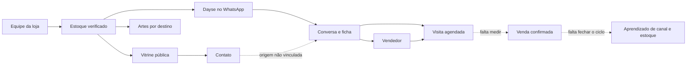

# Liberato Motos Car — diagnóstico de produto e roteiro de mercado

**Revisão:** 06/11/2026. **Objetivo:** decidir o que o sistema já resolve, o que ainda precisa ser comprovado e em que ordem investir para transformá-lo em uma operação de alto valor para revendas.

## 1. Como ler este diagnóstico

Há quatro estados diferentes, que não devem ser confundidos:

1. **Implementado:** existe no código e tem um caminho de uso.
2. **Verificado localmente:** passou em teste, build ou ensaio local.
3. **Observado no ambiente publicado:** há evidência atual de deployment ou resposta HTTP.
4. **Validado na loja:** pessoas reais concluíram a tarefa, em aparelhos e contas reais, com resultado comercial medido.

Esta revisão conferiu a branch `main` no commit `a8436bd`, **com alterações locais ainda não commitadas** nas telas de estoque, agenda, conversas e divulgação. `npm test` passou com **923 testes, 37 pulados**; `npm run typecheck`, `npm run lint` e `npm run build` passaram. Os testes pulados incluem integrações que exigem banco de teste. `npm run eval` não foi executado nesta revisão porque chama um modelo real e gera custo.

Na Vercel, a CLI mostrou o projeto `liberatomotoscar` configurado com Node 24.x e um deployment de produção `Ready` criado em 06/11/2026. `https://liberatomotoscar.vercel.app` respondeu **HTTP 200** nesta revisão. A CLI não confirmou o commit do deployment; as mudanças locais citadas acima **não são consideradas publicadas**. A lista de variáveis de produção foi consultada apenas pelos nomes, sem ler valores. Nenhum teste autenticado de estoque, arte, conversa ou número comercial foi feito em produção nesta auditoria.

**Conclusão de prontidão:** a base técnica é demonstrável e o site está acessível. O conjunto é uma **base para piloto assistido em uma loja**, não um produto multiloja pronto para venda em escala. A decisão de abrir aquisição orgânica e prometer automação confiável depende dos gates da seção 6.

## 2. Qual problema o produto pretende resolver

Uma revenda pequena precisa publicar o estoque, divulgar cada veículo, atender interessados, marcar visitas e saber o que virou venda. O diferencial possível deste projeto é fazer essas tarefas lerem **o mesmo registro de veículo e a mesma conversa**, evitando redigitação, anúncio desatualizado e perda de contexto na passagem para o vendedor. Isso é uma **hipótese de posicionamento**, ainda não uma vantagem validada pelo mercado.

As setas tracejadas mostram lacunas de produto: o link do site abre o WhatsApp, mas não comprova que o contato virou uma conversa registrada com origem atribuída; também não existe um registro estruturado de venda atribuída ao atendimento nem um painel que mostre o retorno de cada canal.

## 3. Inventário do que o código entrega

| Capacidade | Estado confirmado no código | Limite atual / evidência que falta |
| --- | --- | --- |
| **Vitrine e detalhes** | A página inicial lê veículos do banco; publicados e reservados aparecem na lista, vendidos permanecem no detalhe histórico; contato por WhatsApp e metadados por anúncio. [`page.tsx`](../src/app/page.tsx), [`service.ts`](../src/server/vehicles/service.ts), [`InventoryDetail.tsx`](../src/components/vehicles/InventoryDetail.tsx). | O [`layout.tsx`](../src/app/layout.tsx) mantém `robots: noindex`; não há tráfego orgânico demonstrado. Fotos, preços e disponibilidade precisam de revisão da loja. |
| **Estoque administrativo** | Google OAuth mais `admin_grants`; cadastro, edição, fotos, capa, situação, versão otimista, auditoria e descarte controlado. [`schema.ts`](../src/server/db/schema.ts), [`service.ts`](../src/server/vehicles/service.ts). | Aceite do proprietário em fluxo real, rotina de atualização da disponibilidade e ensaio de recuperação ainda não comprovados aqui. |
| **Estúdio de artes** | Arte JPEG para Feed, Stories, Status e TikTok, com prévia, legenda, compartilhamento nativo quando suportado e download como alternativa. [`destinations.ts`](../src/components/art-studio/destinations.ts), [`ArtEditor.tsx`](../src/components/art-studio/ArtEditor.tsx). | É preparação para publicar, **não publicação automática**. Áreas seguras e aparência final precisam ser conferidas nos aplicativos e aparelhos da loja. Não há calendário nem histórico de artes. |
| **Dayse no WhatsApp** | Webhook com assinatura, idempotência, token da conta, consulta somente a veículos publicados, guardas de resposta, cota, fallback e handoff. [`webhook-handler.ts`](../src/server/whatsapp/webhook-handler.ts), [`whatsapp-turn.ts`](../src/server/agent/whatsapp-turn.ts), [`agent-catalog.ts`](../src/server/vehicles/agent-catalog.ts). | Variáveis configuradas e testes automatizados não provam entrega no número real, qualidade de conversas ou custo por resultado. O modelo padrão do código é via OpenRouter; Jev e AI Gateway não estão integrados aqui. |
| **Caixa de conversas** | Filtros, histórico, assumir/devolver/encerrar, resposta humana e indicação de visita. [`atendimento/page.tsx`](../src/app/admin/(protected)/atendimento/page.tsx), [`inbox.ts`](../src/server/attendance/inbox.ts). | Acompanhamento operacional de equipe, tempos de resposta e revisão amostral precisam ser medidos. |
| **Agenda** | Visitas feitas pela Dayse ou lançadas manualmente, agrupadas por data; correção e cancelamento. [`appointments.ts`](../src/server/attendance/appointments.ts), [`agenda/page.tsx`](../src/app/admin/(protected)/agenda/page.tsx). | Não há confirmação de comparecimento, lembrete automático, desfecho de venda nem taxa de conversão confiável. |
| **Medição** | Consentimento para tags opcionais, eventos de visualização e clique, consultas de métricas de conversa/uso no backend. [`AnalyticsConsent.tsx`](../src/components/marketing/AnalyticsConsent.tsx), [`metrics.ts`](../src/server/attendance/metrics.ts). | Pixel/GA não constavam entre os nomes de variáveis de produção listados nesta revisão. Não há painel de métricas nem vínculo completo de origem → conversa → visita → venda. |
| **Operação de dados** | Neon/PostgreSQL, R2 privado, migrações Drizzle, fila de limpeza de objetos e função de expurgo de conversas. [`schema.ts`](../src/server/db/schema.ts), [`cleanup.ts`](../src/server/storage/cleanup.ts), [`conversation-repository.ts`](../src/server/attendance/conversation-repository.ts). | Não foi identificado agendamento automático de expurgo/reconciliação, nem teste de restauração de backup. Retenção de 30/180 dias no código ainda é hipótese sujeita à decisão da loja. |

**O que não existe como produto hoje:** chat público no site, integração de anúncios/leads com portais, publicação social automática, CRM com etapa de venda, relatórios de margem/ROI, cobrança SaaS e isolamento integral de estoque por loja. `SITE_CHAT_ACCESS` e `DEMO_AI_ENABLED` constam no ambiente, mas não há interface ou rota de chat público em `src/app`.

## 4. Arquitetura e fontes de verdade

| Dado / ação | Fonte atual | Quem pode alterar / consumir |
| --- | --- | --- |
| Veículo, preço e situação | `vehicles` e `vehicle_images` no PostgreSQL; imagem no R2 | Admin altera; vitrine e Dayse consultam projeções diferentes. A Dayse só recomenda `published`. |
| Conversa e passagem ao humano | `conversations`, `conversation_messages`, `handoffs` | Webhook registra entrada; IA ou vendedor responde conforme `owner` e reserva de turno. |
| Visita | `visit_appointments` | Dayse registra a partir da conversa; admin registra/corrige manualmente. |
| Configuração do WhatsApp | `channel_settings` e `whatsapp_tenants` | Admin configura; webhook usa o número e token da conta correspondente. |
| Arte | Dados do veículo + estado temporário no navegador | Operador gera/compartilha; arquivo final e publicação não são persistidos pelo sistema. |

A tabela de números do WhatsApp usa identificador de tenant, mas o estoque, a vitrine, as regras da loja e o painel continuam globais. Para atender uma segunda revenda com segurança seria necessário projetar e testar isolamento em **todas** as consultas, uploads, artes, conversas, permissões e métricas. Não tratar a presença de `tenantId` como multi-tenancy pronta.

## 5. Riscos concretos que mudam a prontidão

| Prioridade | Achado verificável | Consequência e ação recomendada |
| --- | --- | --- |
| **P0 — antes de prometer automação** | A tela oferece “Atendimento por menu”, mas [`runWhatsappAgentTurn`](../src/server/agent/whatsapp-turn.ts) retorna sem resposta para qualquer modo diferente de `ai`. | O operador pode acreditar que há menu atendendo enquanto o cliente não recebe resposta automática. Implementar o menu e testar no canal ou retirar essa opção da tela. |
| **P0 — controle de custo/abuso** | [`reserveAiRequest` e `consumeRateLimit`](../src/server/attendance/limits.ts) permitem continuar quando a operação de limite no banco falha. | O teto não é garantido durante falha da sua fonte de controle. Definir comportamento de falha seguro e testar indisponibilidade do banco antes de escalar o canal. |
| **P0 — continuidade do WhatsApp** | `WHATSAPP_TOKEN_ENCRYPTION_KEY` não apareceu na lista de nomes de variáveis de produção da Vercel; [`crypto.ts`](../src/server/whatsapp/crypto.ts) deriva a chave de outro segredo nessa ausência. | Rotação do segredo de origem pode tornar tokens salvos ilegíveis. Planejar chave dedicada e migração/regravação dos tokens com ensaio e rollback; não trocar a chave às cegas. |
| **P0 — prova operacional** | Deployment `Ready` e HTTP 200 foram observados, mas nenhum fluxo autenticado ou conversa real foi ensaiado nesta revisão. | Validar com contas e aparelhos autorizados: anúncio → arte → mensagem → handoff → visita. Registrar falhas e tempo por etapa. |
| **P1 — medição do valor** | [`metrics.ts`](../src/server/attendance/metrics.ts) conta intenção de visita nos fatos da conversa, não a tabela de agendamentos; [`analytics.ts`](../src/lib/analytics.ts) ainda rotula um evento de veículo como `vitrine_ilustrativa`. | Corrigir definições e instrumentar fatos confirmados. Clique, intenção de visita, visita agendada, comparecimento e venda são eventos diferentes. |
| **P1 — dados e retenção** | Existe função de expurgo e fila de limpeza, mas não foi identificado job periódico no repositório ou em `vercel.json`. | Definir política com a loja, agendar execução observável e testar restauração de backup. |
| **P1 — crescimento orgânico** | O `noindex` global está ativo. | Depois de revisar domínio, anúncios, fotos, privacidade e SEO, decidir liberação de indexação e monitorar Search Console; não remover apenas para aumentar tráfego sem operação pronta. |

“P0” aqui significa decisão necessária **antes de vender o comportamento correspondente como confiável**, não uma ordem para alterar produção automaticamente. Não se conhece ainda frequência de falhas, custo ou perda de vendas; essas grandezas precisam de medição.

## 6. Gates de liberação

| Uso pretendido | Situação em 06/11/2026 | Evidência mínima para dizer “pronto” |
| --- | --- | --- |
| **Demonstração guiada** | **Condicional.** Testes, build e acesso público básicos passaram; dados reais e fluxos autenticados ainda não foram conferidos nesta revisão. | Operador entra no painel, escolhe veículo aprovado pela loja, exporta arte e mostra uma conversa de teste sem erro. |
| **Operação assistida em uma loja** | **Condicional.** Código dos fluxos existe, mas a revisão não comprovou o ciclo externo em produção. | Semana de uso com responsável pela fila, ensaio no número autorizado, falhas tratadas, dados/fotos aprovados, cota e recuperação verificados. |
| **Aquisição orgânica pelo site** | **Ainda não.** `noindex` global. | Conteúdo e disponibilidade aprovados, domínio e medição corretos, decisão explícita de indexação, monitoramento de tráfego e contato. |
| **Produto multiloja/SaaS** | **Não.** Domínio de estoque e painel é de uma loja. | Demanda confirmada de segunda revenda, modelo de permissões e segregação, testes com duas lojas antes do atendimento, operação de suporte, cobrança e custos por cliente. |
| **Valor comercial comprovado** | **Não comprovado nesta revisão.** | Linha de base e piloto que meçam tempo economizado, conversas úteis, visitas e vendas confirmadas, com custo total. |

## 7. Estudo de mercado: ponto de partida verificável

O mercado não justifica automaticamente este produto; ele indica **onde pesquisar**. A [FENAUTO informou 14,2 milhões de veículos usados negociados de janeiro a setembro de 2026, alta de 5,4% frente ao mesmo período de 2025](https://www.fenauto.org.br/news/segmento-de-veiculos-usados-registra-pequena-retracao-em-setembro). Esse é um dado nacional de transações, não o tamanho do mercado endereçável para este software em Fortaleza.

| Alternativa observada | O que a fonte do próprio fornecedor anuncia | Implicação para a hipótese Liberato |
| --- | --- | --- |
| [VAPO App](https://vapo.ptibr.com.br/termos.pdf) | Artes automáticas, catálogo digital e calendário de postagens. | Arte e vitrine isoladas não bastam como diferenciação. Comparar tempo real de cadastro → peça pronta → publicação e tarefas semanais do lojista. |
| [OLX para profissionais](https://olxpay.olx.com.br/s/article/como-funcionam-planos-profissionais) | Distribuição de anúncios, recepção de leads e integração com sistemas; há [documentação oficial de integração de leads de Autos](https://developers.olx.com.br/lead/home.html). | Portal é canal de demanda. Estudar como o sistema pode receber/atribuir leads dele, sem presumir acesso à API ou contrato. |
| [Meta Business Agent](https://about.fb.com/br/news/2026/06/conversations-2026-apresentamos-o-meta-business-agent/amp/) | A própria Meta descreve resposta, recomendação, agendamento e intervenção humana. | “Ter IA no WhatsApp” sozinho tende a ser pouco defensável. Investigar se dados verificados da loja, fluxo de venda e medição tornam a solução melhor para esse nicho. |
| [Perfil da Empresa no Google](https://business.google.com/br/business-profile/) | Descoberta local, fotos, avaliações e métricas de interação. | Verificar a jornada Busca/Maps → vitrine/WhatsApp → visita; o perfil e o site precisam de dados consistentes. |

**Limite desta comparação:** são materiais públicos dos fornecedores, consultados em 06/11/2026, não testes com conta paga nem comparação de preço/qualidade. Produtos, planos, APIs e permissões mudam. Revalidar antes de proposta comercial.

### Perguntas que a pesquisa precisa responder

1. **Quem compra:** dono de uma revenda pequena, gerente ou equipe de marketing? Quantos veículos, vendedores e canais usam de fato?
2. **Trabalho atual:** quanto tempo leva para cadastrar um veículo, criar arte, publicar, responder, marcar visita e atualizar “vendido”? Onde há redigitação ou perda de lead?
3. **Alternativas pagas:** quais ferramentas a loja usa hoje, quanto paga, quais funções usa toda semana e o que perderia ao trocar?
4. **Canais:** de onde vêm contatos que viram visita e venda: Google, Instagram, WhatsApp, indicação ou portais? Qual parte pode ser atribuída com evidência?
5. **Confiança:** em que situações o proprietário aceita resposta automática e quando exige vendedor? Que erro da IA seria intolerável?
6. **Compra:** qual melhoria concreta justificaria assinatura e implantação? Quem aprova, qual orçamento e que prova de retorno exigem?

**Método sugerido:** selecionar revendas independentes da região que tenham porte próximo ao da Liberato em número de veículos, vendedores e canais de captação; registrar essas três características para permitir comparações. Entrevistar 5–8 donos/gerentes e 3–5 vendedores; observar ao menos 3 jornadas completas no celular sem guiar a pessoa; registrar ferramenta atual, tempo por tarefa, erro, retrabalho e frase literal do participante. Não tratar elogio à interface como disposição de pagar. Depois, rodar um piloto de 30 dias com a Liberato ou outra loja autorizada: medir uma linha de base antes da mudança, manter a mesma definição de eventos e registrar campanhas, composição do estoque e equipe em ambos os períodos. Cada visita e venda atribuída precisa de confirmação humana e origem declarada/registrada, com a categoria “origem desconhecida” quando não houver prova. Os tamanhos de amostra servem para descobrir padrões e objeções, não para inferência estatística do mercado inteiro.

### Quadro de comparação a preencher nas entrevistas

| Tarefa | Solução atual | Tempo/erro atual | Liberato no piloto | Mudança observada | Valor para quem paga |
| --- | --- | --- | --- | --- | --- |
| Cadastrar e manter estoque | A levantar | A medir | A medir | A calcular | A perguntar |
| Criar e publicar peça | A levantar | A medir | A medir | A calcular | A perguntar |
| Responder e passar ao vendedor | A levantar | A medir | A medir | A calcular | A perguntar |
| Converter visita em venda | A levantar | A medir | A medir | A calcular | A perguntar |

## 8. Métricas do piloto e economia unitária

Definir os eventos **antes** de construir um painel. Uma medição útil para o dono inclui:

| Métrica | Definição operacional | Disponibilidade atual |
| --- | --- | --- |
| Tempo de cadastro/publicação | Minutos entre início do cadastro e anúncio revisado/publicado | Cronometrar no piloto; o banco tem timestamps, mas não o início humano da tarefa. |
| Tempo para divulgar | Minutos para produzir peça correta e concluir a publicação no aplicativo | Cronometrar; o sistema não confirma que a rede publicou. |
| Primeira resposta útil | Tempo entre mensagem do cliente e resposta que avança a conversa | Há timestamps; “útil” exige regra e amostra humana. |
| Handoff perdido | Conversa que pediu vendedor e ficou sem atendimento dentro do prazo acordado | Eventos existem; falta meta de serviço e painel/alerta. |
| Visita e comparecimento | Visita registrada, confirmada e realizada, separadamente | Registro existe; confirmação e comparecimento faltam. |
| Venda atribuída | Venda confirmada ligada a veículo, conversa, canal e período | Não existe o fechamento desse ciclo. |
| Custo por resultado | Vercel + Neon + R2 + OpenRouter + Meta + suporte ÷ visitas qualificadas ou vendas atribuídas | Requer faturas/uso real; não estimar só por preço de token. |

O painel de métricas deve informar denominador, período e fonte. “Clique no WhatsApp” não pode entrar como lead confirmado; “cliente falou em visitar” não pode entrar como visita realizada. Para comparar antes/depois, anotar sazonalidade, mudanças de estoque, campanhas e equipe.

## 9. Ordem de evolução proposta

| Ordem | Entrega ou decisão | Aceite mensurável | Por que agora |
| --- | --- | --- | --- |
| **1. Verdade e segurança do fluxo** | Revisar anúncios/fotos, testar WhatsApp real e handoff, corrigir ou remover modo menu, garantir limites e chave de token dedicada com migração segura. | Roteiro completo passa em conta autorizada; nenhuma conversa fica silenciosa por modo mal descrito; falha de controle de custo tem comportamento definido. | Sem isso, a promessa central pode falhar na frente do cliente. |
| **2. Operação assistida e medição** | Nomear responsável pela fila, rotinas de expurgo/backup, registrar comparecimento e venda; corrigir definições de métricas e rótulos de analytics. | Uma semana de operação com incidentes registrados; piloto produz funil com dados auditáveis. | Prova se o conjunto agrega valor e onde perde tempo. |
| **3. Reduzir trabalho repetido** | Melhorar passagem de contexto, alerta de visita/handoff, fluxo de divulgação e, se houver demanda comprovada, calendário e integração de leads de portais. | Tempo por veículo e handoff cai na comparação com a base; erros de estoque/arte não aumentam. | Diferencia pelo fluxo integrado, não pela soma de botões. |
| **4. Escala comercial** | Após confirmar demanda de uma segunda revenda e **antes de atendê-la**: isolamento multiloja, papéis, configuração por loja, suporte, cobrança e observabilidade por tenant. | Testes de segregação com duas lojas e economia unitária positiva. | Evita vender como SaaS uma implantação que ainda depende de regras globais. |

O próximo investimento deve sair de uma decisão: **qual tarefa cara e frequente o piloto comprovou melhorar?** Se a resposta for criação de artes, aprofundar divulgação; se for perda de atendimento, priorizar fila e handoff; se for conversão, fechar visita e venda. Não adicionar IA ou integrações por disponibilidade técnica apenas.

## 10. Evidências e manutenção deste documento

- **Código atual:** [`src/app`](../src/app), [`src/server`](../src/server), [`src/components/art-studio`](../src/components/art-studio), [`src/server/db/schema.ts`](../src/server/db/schema.ts), [`package.json`](../package.json) e [`vercel.json`](../vercel.json).
- **Roteiros úteis:** [conferência das artes](liberato-inteligente/05-CONFERENCIA-ESTUDIO-ARTES.md), [validação do catálogo](VALIDACAO_CATALOGO.md), [plano de avaliação do agente](PLANO-AGENTE-IA-ATENDIMENTO.md).
- **Documentos históricos:** [roadmap anterior](liberato-inteligente/06-ROADMAP-EXECUCAO.md) e [auditoria de UX de 02/11](auditorias/AUDITORIA-UX-ADMIN-LIBERATO.md). Eles descrevem o estado das respectivas datas; algumas pendências já foram alteradas e não devem ser copiadas como estado atual.
- **Fontes externas:** links diretos na seção 7. Reconsultar dados de mercado, produto, preço e regras antes de proposta ou integração.

Ao atualizar este diagnóstico, registrar data, commit/deployment examinado, teste executado, resultado observado na loja e responsável por cada gate. A primeira reunião útil com o proprietário deve preencher: dados e fotos aprovados, número/contas autorizados, rotina de atendimento humano, ferramentas pagas atuais, custo por mês e objetivo de negócio do piloto.
