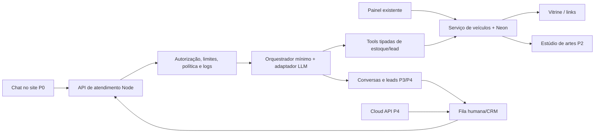
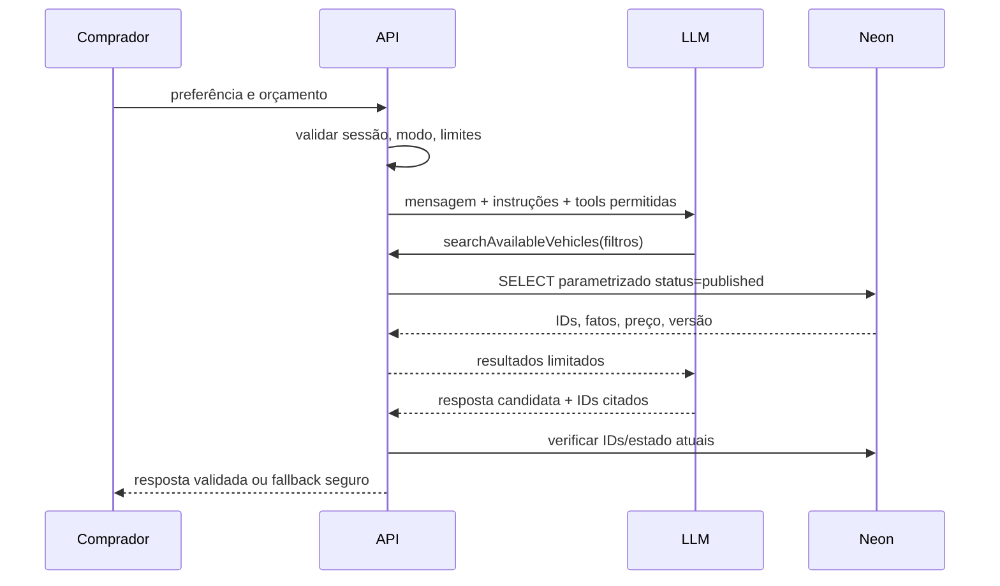

# Liberato Inteligente — diagnóstico e arquitetura

**Data da auditoria:** 26/10/2026. **Natureza:** análise estática do `main` em `456dcde`, documentação e fontes oficiais; nenhum teste contra produção ou alteração de serviço nesta missão. Evidência no código indica capacidade implementada, não funcionamento no endereço público. O diagnóstico de publicação em `docs/DIAGNOSTICO_PUBLICACAO_CATALOGO_2026-10-26.md` registrou um teste local real e produção ainda no commit antigo naquele momento; reconfirmar o deployment antes da demonstração. Há dois arquivos comerciais não rastreados preexistentes em `docs/`, preservados.

## Objetivo e limites

Planejar um cadastro único que alimente vitrine, catálogo, artes, atendimento e oportunidades. Aqui estão incluídas decisões e interfaces entre módulos; estão excluídos implementação, migração, deploy, WhatsApp real e multi-tenancy no MVP.

## Estado observado

| Área | Evidência no repositório | Juízo / validação pendente |
| --- | --- | --- |
| Stack | `package.json`: Next 16.4.2, React 19.3, TypeScript, Drizzle, postgres.js, Zod, Auth.js beta, AWS S3 SDK, Vitest; `package-lock.json`; Node local 26.8.1 | Compatibilidade de bibliotecas novas exige teste com a versão do projeto. Não há `ai`, Mastra, LangGraph nem editor gráfico instalado. |
| Estoque | `src/server/db/schema.ts`, `src/server/vehicles/service.ts`, `validation.ts`: veículos, fotos, estados, versão otimista e auditoria transacional | Os serviços existem; disponibilidade operacional depende de Neon, dados corretos e deployment atual. `availabilityConfirmedAt` é atualizado na publicação, sem prazo de validade. |
| Vitrine | `src/app/page.tsx` busca `listPublicVehiclesWithCover`; `Showcase` filtra moto/carro; detalhe em `src/app/veiculos/[slug]/page.tsx` | `published` e `reserved` entram na lista. `sold` permanece acessível no detalhe por slug, mas `InventoryDetail` conserva CTA “Consultar veículo” e não evidencia indisponibilidade com destaque. |
| Conceitos | `mock-vehicles.ts` e fallback no detalhe quando slug não está no banco | São páginas ilustrativas com aviso, porém a IA deve consultar **somente** `vehicles`, jamais esses dados. Evitar colisão de slug real com conceito. |
| Administração | Auth.js Google e `admin_grants`; `requireAdmin` em cada serviço; editor móvel com autosave, foto, capa, publicar, reservar, vender, arquivar, descartar | Fluxo suportado por código e testes. `StatusActions` vende sem confirmação específica. Para `reserved/sold -> published`, a tela não envia `confirmAvailability=true`, exigido pelo serviço: republicação deve falhar até correção. A elegibilidade do usuário real e o fluxo no deploy ainda requerem ensaio. |
| Fotos | R2 privado via URL assinada de 15 min, validação de assinatura JPEG/PNG/WebP, compensação após falha | `discardDraft` mantém linha/auditoria e remove associações de fotos; falha de delete R2 é silenciada e pode deixar órfãos. URL assinada expira em tela longa e pode exigir recarga. |
| Segurança / operação | `src/server/authz.ts`, checagens Zod, controle de versão, checks do banco, `revalidatePath`; `next.config.ts` limita server action a 4 MB | Não há rate limit distribuído para chat, controle de custo LLM, retenção de conversa nem rotina de reconciliação R2. Não confundir `revalidatePath` com confirmação de atualização em produção. |
| Contato / métricas | Links `wa.me` e eventos de clique/visualização condicionais; `src/app/layout.tsx` define `noindex` | Não há API WhatsApp, recebimento de mensagens, CRM ou comprovação de venda. Analytics depende de configuração e consentimento. |
| Testes | Vitest com testes unitários, componentes e integração condicional; diagnóstico anterior relata 225 aprovados/27 pulados | Não executar suite de integração contra banco compartilhado sem isolamento: testes podem escrever dados. Validar novamente em branch/banco de teste. |

**Dados atuais:** `vehicles` guarda categoria, marca, modelo, versão, ano, quilometragem, cor, preço em centavos, descrição, status e versão; `vehicle_images` guarda fotos/capa; `vehicle_audit` é histórico. Não há campos estruturados para entrada, parcela, financiamento, troca, proprietário, margem ou promoção. O agente não pode afirmar esses dados. `reserved` é visível, mas não deve ser recomendado como disponível para compra imediata. `sold`, `archived`, `discarded` e `draft` ficam fora das buscas comerciais. Desde P1.1, `isDiscardable` aceita apenas rascunho nunca publicado (`publishedAt == null`), preservando fotos e evidência comercial dos anúncios com histórico.

## Arquitetura proposta

**Decisão A1 — P0:** AI SDK (`ai`) com provider adapter e tools próprias, sem framework de agente maior. O projeto já usa TypeScript/Zod, o fluxo tem poucas ferramentas e precisa caber num dia. O modelo interpreta linguagem natural e escolhe tool; regras de disponibilidade, permissão, orçamento e handoff ficam no backend. Se a versão mais recente do SDK não for compatível, usar cliente HTTP compatível com tool calling com contrato próprio; nenhuma resposta simulada. **Decisão A2:** cada fonte de verdade permanece no serviço de estoque, com consulta somente leitura e projeção pública mínima. **Decisão A3:** persistência de conversas/leads é passo posterior à demo restrita, antes de abrir atendimento ao público; nenhuma memória em processo serverless como fonte de verdade. **Decisão A4:** separar `channel` e `mode` nos dados de atendimento, inicialmente `site`; futura loja pode ganhar `storeId` nas tabelas novas e adaptadores sem modificar o domínio existente agora. Decisão formal de multi-tenancy só após segundo cliente real, com isolamento e migração planejados.

### Comparação de orquestração

| Opção | Licença / manutenção | Capacidade | Custo de integração / decisão |
| --- | --- | --- | --- |
| [Mastra](https://github.com/mastra-ai/mastra/blob/main/LICENSE.md) | Núcleo Apache 2.0; diretórios `ee/` sob licença empresarial; projeto ativo | Agents, tools, storage, traces, evals | Bom para expansão com fluxos duráveis; configuração/storage e superfície maior para P0. Reavaliar se orchestration/observability próprias crescerem. |
| [LangGraph.js](https://github.com/langchain-ai/langgraphjs) | MIT; projeto ativo | Grafo explícito, checkpoints, interrupção humana | Excelente quando houver estados longos/múltiplos atores; aumenta código e persistência agora. Reavaliar em P4 se handoffs exigirem grafo. |
| [AI SDK + tools locais](https://ai-sdk.dev/providers/openai-compatible-providers) | Pacote `ai` declara [Apache 2.0](https://github.com/vercel/ai/blob/main/packages/ai/package.json); fixar/verificar a versão na execução | Tool calling, modelos/providers; persistência e limites ficam no aplicativo | **Escolhido para P0**: menor dependência, encaixe direto no Next/React. Requer disciplina de logs, testes e policy próprias. |

O adaptador `LanguageModelProvider` deve receber modelo, chave no servidor, timeout e teto de tokens; sua implementação inicial pode usar endpoint compatível de provedor escolhido. OpenRouter fica como opção futura, não como dependência de produção. AI Gateway também é opção futura: a CLI local observada é 50.35.0 e **não reconheceu** `vercel ai-gateway ...` nesta auditoria; o inventário do usuário cita 60.0.1 em outro contexto, portanto orçamento, regras e consumo **não foram confirmados neste ambiente**. Nenhuma credencial ou inferência foi testada. [Documentação de budgets](https://vercel.com/docs/ai-gateway/observability-and-spend/budgets).

**Atualização de 27/10/2026:** o parágrafo anterior registra a decisão na auditoria inicial e foi superado para o P0. O AI Gateway retornou HTTP 403 por verificação de pagamento. A implementação local usa `createOpenRouter` diretamente, com `OPENROUTER_API_KEY` no servidor, `OPENROUTER_MODEL=deepseek/deepseek-v4-pro-0813` e inferência real verificada. Ainda não há deploy do P0. O banco compartilhado por Production e Preview é a branch Neon chamada `production` no projeto dos EUA; `NEON_DEVELOPMENT_BRANCH_ID` permanece como nome legado da variável local. Uma migration aditiva e uma linha de cota foram gravadas nele antes da descoberta do compartilhamento. O teste posterior passou em branch isolada filha, sem gravação adicional no banco compartilhado. O alcance e os bloqueadores estão em `02-PLANO-DEMO-IA.md`.

## Dependências, riscos e decisão de liberação

1. **Antes de P0:** conferir deployment, estoque publicado real, permissão de uso dos dados/fotos e credencial de um LLM com tool calling. Sem isso, demo real fica bloqueada; mostrar a limitação, não simular IA.
2. **P0:** limitar a demo a operador autorizado no próprio site; pré-configurar teto baixo de requisições/tokens e orçamento do provedor. Abrir chat público apenas com rate limit compartilhado, política de retenção e controles antiabuso.
3. **P1:** corrigir detalhes de vendido/reservado, confirmação de venda/republicação, reconciliação de objetos R2; não alterar o editor de cadastro que Elton já aprovou.
4. **P2–P4:** estúdio, modos persistentes, CRM e WhatsApp dependem de acordos comerciais, contas separadas e manutenção operacional.

**Segurança:** nenhuma tool executa SQL vindo do modelo, nem recebe campo de status diretamente do cliente como verdade; ID e filtros são validados por Zod, listagens são limitadas, detalhes fazem nova leitura. Registrar eventos com IDs e métricas, sem prompt integral/telefone em log. Aprovação de promoção e condições financeiras é humana. Base legal, aviso de privacidade e retenção devem ser definidos com responsável da loja; a [ANPD](https://www.gov.br/anpd/pt-br/acesso-a-informacao/perguntas-frequentes) orienta direitos do titular, e o guia de [legítimo interesse](https://www.gov.br/anpd/pt-br/assuntos/noticias/anpd-lanca-guia-orientativo-sobre-legitimo-interesse) deve orientar a avaliação, sem tratar consentimento como regra universal.

**Monitoramento:** disponibilidade do banco e LLM, p95, erros por tool, respostas sem referência, recomendações rejeitadas, tokens/custo, handoff, anúncios encerrados citados e objetos órfãos. **Rollback arquitetural:** desligar a flag do chat ou modo automático; estoque e site atual seguem operando. **Complexidade:** P0 média, P1 baixa–média, P2 média, P3 média, P4 alta. Incerteza maior: credenciais, quotas, volume, dados do estoque e elegibilidade Meta.
