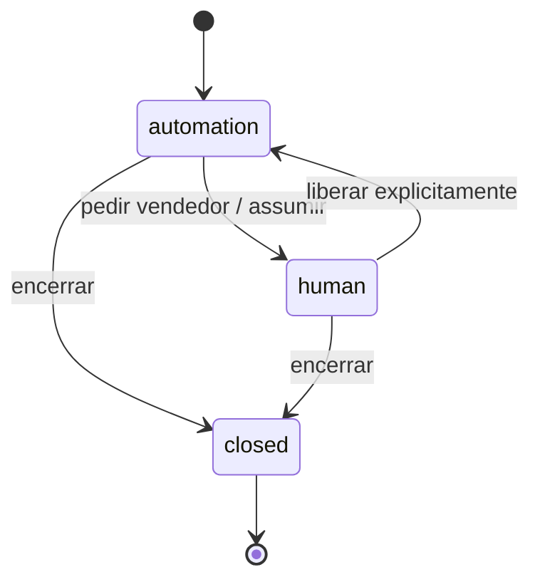

# P3 — modos de atendimento e transferência

**Objetivo:** controlar por canal exatamente um modo `disabled | deterministic | ai`, com histórico preservado e suspensão quando um vendedor assume. Planejar P3 após P2 na prioridade comercial; antecipar apenas uma flag de P0 para desligar a demo imediatamente. **Implementado localmente em 27/10/2026 para o canal `site` (`SITE_CHAT_ACCESS=off` por padrão até aprovação de privacidade e migração no banco compartilhado).** Complexidade média; 3–6 dias úteis condicionais após UX e política de dados aprovadas.

## Escopo e exclusões

Inclui configuração simples no painel, confirmação da mudança, fluxo de bot sem LLM, auditoria, persistência de conversas, transferência e fila básica. Exclui WhatsApp nesta fase, Chatwoot, atribuição avançada, SLA, campanhas e decisão multi-tenant. A configuração `site` inicia; `whatsapp` fica apenas como valor futuro após integração, sem botão funcional prematuro.

## Estados e precedência

| Modo do canal | Resposta ao novo contato | Conversa assumida por humano |
| --- | --- | --- |
| `disabled` | Nenhuma resposta automática; oferecer contato humano | Humano continua |
| `deterministic` | Menus: motos, carros, financiamento, troca, vendedor; busca real sem LLM | Bot suspenso |
| `ai` | Agente P0 com persistência e limites de operação | IA suspensa |

O estado efetivo é `automation_enabled = mode != disabled AND conversation.owner = automation AND conversation.status = open`. `human_assigned` tem precedência sobre modo do canal. Troca de modo afeta **apenas o próximo turno**; turno em curso usa `configVersion` fixada no início e verifica novamente a propriedade antes de enviar. Ao passar para `disabled`, cancelar enfileiramentos e impedir nova emissão; mensagens antigas ficam legíveis. Nunca executar bot e IA para o mesmo evento. Mudança exige `requireAdmin`, auditoria com ator, timestamp, canal, antes/depois e versão. A interface mostra modo atual e texto claro: “Desativado”, “Chatbot”, “IA”; um toque escolhe e outro confirma.

## Persistência e arquivos envolvidos

Migração Drizzle em `src/server/db/schema.ts` e `drizzle/` para `channel_settings(channel PK, mode, version, updatedBy, updatedAt)`, `channel_settings_audit`, `conversations(id, channel, owner, status, createdAt, lastMessageAt, expiresAt, configVersion)`, `conversation_messages(id, conversationId, sender, body, createdAt, providerMetadataMin)`, `lead_interests` e `handoffs`. Separar texto privado de métricas técnicas. Índices em canal/status/data, unicidade para idempotência de eventos e check de enum; FK de ator. Não colocar `storeId` fictício no domínio atual; preparar migration de isolamento quando houver segunda loja. Mudanças aditivas, com rollback por flag, sem remover histórico.

Arquivos previstos: `src/server/attendance/settings.ts`, `conversation-repository.ts`, `deterministic.ts`, `handoff.ts`; `src/app/admin/(protected)/atendimento/page.tsx` e actions; `src/app/api/chat/route.ts` (quando acesso público for aprovado); componentes de chat. Reutilizar `requireAdmin`, `getDb`, `vehicles`, `vehicleAudit` como padrões; auditoria de configuração fica própria, não misturar com `vehicle_audit` cujo FK exige veículo.

## Fluxo determinístico

Menu inicial com opções e texto livre curto. `Ver motos`/`Ver carros` chama a mesma consulta de estoque disponível do agente e devolve até três cards reais. `Financiamento` pede apenas intenção e explica que condições dependem da loja; `Troca` identifica veículo de troca sem avaliação automática; `Falar com vendedor` cria handoff e suspende bot. Resposta de menu não usa LLM e continua quando provedor IA falha **somente se o administrador escolher esse modo**, nunca por troca silenciosa que surpreenda o comprador. Se o banco falhar, informar que a consulta está indisponível e oferecer humano.

**Permissões:** visitante só lê/escreve a própria conversa via token opaco de sessão com expiração; vendedor autorizado vê fila/contatos atribuídos; administrador altera modo e consulta auditoria. O `admin_grants` atual só representa admin: desenhar papel vendedor separado antes de conceder acesso; até lá, usar administradores autorizados como operadores. Toda leitura de conversa precisa de autorização no servidor. Rate limit compartilhado, CSRF/origem e tamanho de mensagem são pré-requisitos para abrir ao público.

**Privacidade:** aviso de IA e finalidade; coleta mínima, consentimento específico para contato posterior quando aplicável, registro de origem/data/versão do aviso. Definir prazo de retenção com a loja antes da migração; proposta para avaliação: conversa sem lead 30 dias, lead com contato 180 dias, métricas agregadas sem identificação por mais tempo. São hipóteses, não regra jurídica. Direito de acesso/exclusão sujeito a obrigações aplicáveis; rotina de expurgo, backup e acesso auditado. Consulte a [ANPD](https://www.gov.br/anpd/pt-br/acesso-a-informacao/perguntas-frequentes).

## Implementação, validação e operação

1. Aprovar texto de atendimento, papéis, retenção e uso do WhatsApp como handoff manual.
2. Criar migration aditiva e repositórios transacionais; testar concorrência em alteração de modo/assunção humana.
3. Implementar motor determinístico e testes de cada caminho com estoque vazio, vendido, reservado e falha de banco.
4. Implementar painel com `requireAdmin`, mudança otimista por versão, auditoria e confirmação.
5. Integrar chat com transação/lock ou compare-and-swap para reservar resposta; descartar resposta LLM tardia se humano assumiu.
6. Ensaiar ponta a ponta com contas de teste; liberar em etapas por flag.

**Aceite:** exatamente uma resposta automática por evento; `disabled` não chama LLM; bot não chama LLM; mudança no painel é auditada; conversa e histórico sobrevivem reload/deploy; humano impede respostas automáticas subsequentes; usuário sem papel é barrado; limites e retenção funcionam. **Monitorar:** mudanças de modo, fila de handoff, automações bloqueadas, duplicatas, tempo de resposta e erros. **Rollback:** colocar `disabled`, manter tabelas/histórico e ocultar nova UI; migrations aditivas não são revertidas destrutivamente. **Risco principal:** concorrência no serverless e papéis ainda inexistentes; resolver com estado no banco e teste de corrida, não variável global.
