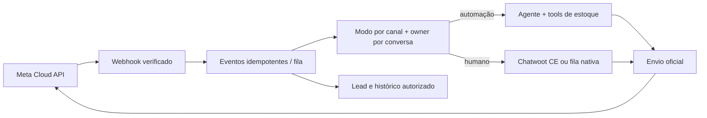

# P4 — WhatsApp oficial, atendimento humano e CRM

**Objetivo:** receber e enviar mensagens por canal oficial, manter contexto e permitir que vendedor assuma sem respostas simultâneas. Este plano é **posterior** ao chat no site, estúdio e controle de modos. Não conectar o número comercial de Elton agora. Complexidade alta; estimativa condicional 3–6 semanas após acesso/elegibilidade Meta, escopo de inbox e equipe definidos, com risco de aprovação externa.

**Inclui:** canal oficial, inbox humano, histórico, qualificação e pipeline simples. **Exclui:** automação por WhatsApp Web, campanha em massa, CRM genérico de vendas, conexão com SalesNet/Sofia e IA do Chatwoot Premium. **Pré-requisitos:** P3 estável, política de privacidade, vendedor responsável, titularidade da WABA, número de teste, orçamento e plano de incidentes aprovados.

## Escolha condicionada

**Canal:** Meta WhatsApp Cloud API com webhooks oficiais, WABA e número/conta da Liberato. Não usar automação de WhatsApp Web em produção. **Inbox humano:** avaliar piloto do Chatwoot Community Edition separado do app Next. O [Chatwoot CE](https://www.chatwoot.com/community) anuncia inbox compartilhada, live chat, WhatsApp, automações e relatórios; [licença MIT no código comunitário](https://github.com/chatwoot/chatwoot/blob/develop/LICENSE), com diretório `enterprise/` separado. [Captain AI, SSO/SLA e outros recursos premium](https://www.chatwoot.com/pricing/self-hosted-plans) não fazem parte da CE. Se equipe/volume forem pequenos, uma fila nativa simples no painel pode ser mais barata de operar; decidir por prova de valor e TCO, não por popularidade.

| Opção | Vantagem | Custo/risco | Condição de adoção |
| --- | --- | --- | --- |
| Cloud API + Chatwoot CE | Inbox, operadores e histórico maduros | Serviço Rails separado, PostgreSQL/Redis/workers, backup, upgrades, integração com nosso agente | Piloto isolado com número de teste, recursos CE validados na versão instalada |
| Cloud API + inbox própria mínima | Menos infraestrutura externa e controle de domínio | Construir UX de fila, permissões e operação; maior esforço de produto | Apenas se fluxo de 1–2 vendedores e requisitos modestos forem confirmados |
| BSP oficial | Pode facilitar onboarding/coexistência | Taxas, contrato e limites extras | Comparar oferta formal e titularidade dos dados/conta |

Chatwoot self-hosted exige infraestrutura própria; o [guia de deployment](https://www.chatwoot.com/deploy) recomenda CPU/RAM/SSD, Postgres e Redis. Não tentar executá-lo dentro da Function Vercel do Next nem presumir que o Neon atual comporta sua carga/versão. Separar banco, backups, métricas e credenciais. O motor de IA continua na aplicação Liberato e recebe eventos por integração própria; Chatwoot não vira fonte de verdade do estoque.

## Coexistência e preparação externa

A [documentação de conexão do Chatwoot](https://www.chatwoot.com/hc/user-guide/articles/1677832735-how-to-setup-a-whats_app-channel) descreve caminho de coexistência com o Business App via Quick setup e caminhos de configuração manual que podem não mantê-lo. **Elegibilidade varia por conta, método e versão:** confirmar com Meta/Chatwoot ou BSP no portfólio da Liberato antes de tocar no número real; testar primeiro com número separado. Não prometer preservação do histórico do aplicativo nem migração automática. Definir proprietário do Meta Business Portfolio/WABA, aprovação de nome, pagamento, templates, permissões, webhook público HTTPS, token e rotação. Credenciais da Liberato ficam próprias; não reutilizar SalesNet/Sofia.

## Arquitetura e dados

Webhook valida assinatura, challenge e formato, grava ID externo único, responde rapidamente e processa assíncrono; retries da Meta não podem duplicar mensagem/lead/resposta. Tabelas novas propostas: `channel_accounts`, `external_events(provider,eventId,receivedAt,processedAt,status)`, vínculo `conversation_channel_ids`, `outbound_messages(idempotencyKey,providerMessageId,status)`, `lead_interests`, `lead_events`, `handoffs`. Índice único em `(provider,eventId)` e no ID externo da mensagem; status de entrega atualiza o mesmo registro. Ordenar eventos por conversa com lock/fila; processar status fora de ordem sem retroceder. Acesso do vendedor por papel e escopo de conversa; auditoria de atribuição, leitura sensível e mudança de estado. O registro de lead liga fatos fornecidos, veículo de interesse e próximo passo, sem supor valor de troca/credito aprovado.

**Arquivos previstos:** `src/server/channels/whatsapp/{webhook,send,mapper}.ts`, `src/server/attendance/{conversation-repository,handoff,lead-repository}.ts`, `src/app/api/webhooks/whatsapp/route.ts`, `src/app/admin/(protected)/atendimento/` e migration em `src/server/db/schema.ts`/`drizzle/`. Se Chatwoot for adotado, seu deployment e configuração ficam em repositório/serviço isolado, com adapter em `src/server/channels/chatwoot/`; nunca embutir credenciais Meta ou Chatwoot no cliente. Nomes são propostos, sujeitos a convenções da execução.

**Sessão de atendimento:** respeitar janela e templates aprovados pela Meta, sem modelar “24 h” como autorização para marketing. Conversa humana suspende o agente no backend antes da primeira resposta do vendedor; retomada automática exige ação explícita. Se automação desativada/provedor falho, mensagem entra na fila humana; nunca dois emissores. Antes de mencionar veículo em mensagem de saída, chamar `checkVehicleAvailability` e remover oferta se status mudou. Histórico do canal fica em store próprio do atendimento com política de retenção; Chatwoot, se adotado, é inbox operacional e integra por IDs, não espelho irrestrito de dados.

## Qualificação e CRM enxuto

Fases: `novo`, `pesquisando`, `requisitos_definidos`, `pronto_para_vendedor`, `em_atendimento`, `ganho`, `perdido`, `sem_contato`. Sinais: categoria/modelo, faixa de preço, pagamento, troca, prazo, visita, negociação. Mudanças de fase sugeridas pelo agente precisam ser legíveis e corrigíveis pelo vendedor; “pesquisando” continua acompanhado, sem descarte automático. Tela de oportunidade mostra resumo com fontes/turnos, lacunas, veículos consultados, status atual e próxima ação. Contato/telefone só do canal oficial ou informado pelo titular, com finalidade e acesso mínimos. Não enviar mensagens de prospecção sem base legal e regras da Meta. A [ANPD](https://www.gov.br/anpd/pt-br/acesso-a-informacao/perguntas-frequentes) orienta direitos do titular; política e prazos precisam de revisão jurídica/comercial da loja.

## Implementação e testes

1. Levantar volume, horários, operadores, titularidade de conta/número e custo tolerado; aprovar orçamento separado.
2. Provar Cloud API e webhooks com número de teste, inclusive duplicatas, mídia, falhas, status e limites; verificar coexistência sem migrar Elton.
3. Piloto Chatwoot CE em ambiente isolado **ou** protótipo de inbox nativa; medir esforço mensal, papéis, APIs/webhooks e recuperação de backup.
4. Criar esquema idempotente e adapter de canal; contrato `InboundMessage`/`OutboundMessage` independente do provedor. Integrar modos P3 e ownership.
5. Testar mão humana, retomada, timeout, mensagens fora de ordem, templates/janela, status de veículo alterado, privacidade e segregação de credenciais.
6. Fazer migração controlada do número real **somente** após validação de elegibilidade, aceite da loja e plano de reversão/comunicação.

**Aceite:** mensagem real de número de teste recebida/enviada via API oficial; duplicata não gera dupla resposta; humano assume e IA para; histórico e lead são acessíveis só a operador autorizado; falha de IA encaminha sem inventar; backup restaurado em teste; custo e alertas visíveis; número comercial intocado até aprovação. **Monitorar:** lag do webhook, reprocessamentos, taxa de falha/entrega, conflitos humano-bot, fila, custo por categoria e disponibilidade do Chatwoot. **Rollback:** desativar automação, manter inbox humano; se integração Chatwoot falhar, preservar eventos brutos e encaminhar manualmente até restaurar. Desconectar número real pode ter implicações operacionais, por isso não é rollback trivial e requer procedimento validado antes do corte.

**Custos:** [WhatsApp cobra por mensagem entregue conforme mercado/categoria](https://whatsappbusiness.com/products/platform-pricing/), com regras e valores sujeitos a atualização; levantar rate card Brasil no dia da decisão. Somar infraestrutura Chatwoot (servidor, Postgres, Redis, backup, storage, manutenção), LLM, observabilidade e eventual BSP. Não inferir preço zero do atendimento apenas porque o software é CE. Riscos externos: aprovação Meta, coexistência, templates, cobranças e limites de conta.
