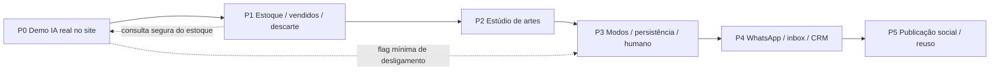

# Roadmap consolidado — Liberato Inteligente

**Referência:** auditoria em 26/10/2026 e inferência real local com DeepSeek em 27/10/2026, ainda sem deploy do P0. O pedido comercial inicial de **R$ 700 implantação / R$ 200 mensais** não financia automaticamente IA, artes, CRM e WhatsApp. Há outros valores sugeridos em documentação comercial preexistente, também sem aceite comprovado. Cada módulo abaixo precisa de proposta e aceite separados. As estimativas são esforço técnico **hipotético**, não prazo contratual; dependem de acesso, dados aprovados, uma pessoa familiarizada com o código e ausência de retrabalho externo.

**Escopo do roadmap:** sequenciar entregas e decisões de investimento. **Fora do escopo:** instalar serviços, aprovar gastos, alterar produção ou prometer retorno comercial. **Arquivos/mudanças de dados/testes por fase:** detalhados em `02`–`05` e no P1 abaixo; executar migrations apenas em ambiente isolado após revisão. Cada gate usa testes automatizados e ensaio com dados controlados. Acesso a conversas/estoque e segregação de credenciais são requisitos de segurança transversais.

## Ordem obrigatória e dependências

P0 reutiliza agora uma projeção segura de estoque e flag de desligamento, sem esperar o P1 completo. P1 melhora consistência antes de divulgar IA ao público. P3 antecipa apenas a política de privacidade e o desenho de handoff necessários para P0; persistência e painel de modo continuam na fase própria.

**Onde entra o Chatwoot:** a demo P0 usa interface e orquestração implementadas no próprio site, com AI SDK, modelo via OpenRouter e ferramentas de estoque; ela não usa Chatwoot nem treina um modelo novo. O Chatwoot Community Edition está previsto para avaliação na P4 como inbox de operadores no canal WhatsApp oficial. Seu piloto, infraestrutura separada, integração com o agente e decisão final estão detalhados em `05-PLANO-WHATSAPP-CRM.md`, seções “Escolha condicionada”, “Arquitetura e dados” e “Implementação e testes”. O Chatwoot ainda não está instalado nem integrado; hoje o handoff da demo é apenas um link manual para WhatsApp. A escolha entre Chatwoot e inbox própria permanece pendente de piloto e custo operacional.

| Fase / produto | Entregas e dependências | Aceite verificável | Complexidade / esforço condicional |
| --- | --- | --- | --- |
| **P0 — MVP demonstrável** | Rota no site restrita a admin; LLM real, tools de estoque, filtros, qualificação efêmera, resumo e link humano. Depende de chave, estoque real conferido, deploy correto. | Casos de `02` aprovados com modelo real; nenhum vendido/ilustrativo recomendado; teto de custo e fallback comprovados. | Média; 1–2 dias úteis se pré-requisitos prontos. Alto risco de credencial/deploy para 27/10. |
| **P1 — Produto operacional inicial, estoque** | Confirmar vendido/republicação; detalhe vendido sem CTA inadequado; reservado diferenciado; auditoria e limpeza/reconciliação de fotos órfãs; regressão de painel. | Status do painel reflete vitrine e agente; slug vendido mostra indisponível; rascunho descartado sai e histórico fica; imagens reconciliadas. | Baixa–média; 2–4 dias úteis + ensaio em produção autorizado. |
| **P2 — Substituição funcional VAPO, artes** | Botão Criar arte, 6 templates, 3 formatos, exportação e preview; legenda IA opcional. Depende de marca/fotos/contato aprovados. | Elton exporta PNG/JPEG de veículo real nas dimensões exatas; preço/status correto. | Média; 5–10 dias úteis, risco CORS/celular. |
| **P3 — Produto operacional inicial, atendimento** | 3 modos por canal, chatbot sem LLM, histórico, papéis, handoff persistente e retenção. Depende P0/P1 e decisão de privacidade. | Único respondedor, humano suspende automação, histórico e auditoria sobrevivem a deploy. | Média; 3–6 dias úteis após requisitos. |
| **P4 — WhatsApp oficial + CRM** | Número de teste, Cloud API, inbox escolhida, eventos idempotentes, leads e equipe; só depois número real. Depende P3, contas Meta e decisão Chatwoot. | Teste real por API oficial; sem duplicata, segregação, recuperação e custos validados. | Alta; 3–6 semanas, maior incerteza externa. |
| **P5 — Melhoria futura e reuso** | Agendamento/publicação Instagram após validação Graph API/permissões; analytics de funil; extrair módulos reusáveis e plano de `storeId` ao segundo cliente. | Publicação autorizada rastreável; isolamento provado em testes com duas lojas antes de multi-tenant. | Alta/indefinida; estimar só após discovery. |

**Substituição do VAPO:** não declarar concluída com P2 apenas. Fazer inventário lado a lado com Elton: cadastrar/editar, catálogo compartilhável, arte, baixar/publicar, recursos usados semanalmente, custos e tempo por tarefa. Site + painel + P1 + P2 cobrem o núcleo descrito; integração social automática e recursos desconhecidos do VAPO exigem validação própria. Aceite comercial é Elton conseguir operar uma semana sem perda de tarefa essencial, com dados revisados.

O painel VAPO não foi acessado com conta autenticada; suas funções continuam tratadas como relato do cliente. Em pré-voo posterior, o site público da Liberato respondeu HTTP 200, um anúncio publicado abriu com HTTP 200 e a consulta Neon de leitura confirmou estoque publicado. O login administrativo em produção e o commit exato do deployment ainda precisam de conferência antes de anunciar substituição.

### P1 — plano operacional detalhado

**Escopo:** em `src/app/admin/(protected)/veiculos/[id]/{StatusActions,VehicleEditor,DangerActions}.tsx`, `src/server/vehicles/{service,validation}.ts`, `src/app/veiculos/[slug]/page.tsx`, `src/components/vehicles/InventoryDetail.tsx` e testes correspondentes: confirmação clara para “Vendido”, confirmação de disponibilidade para republicar (`reserved/sold -> published`), estado vendido visível no slug antigo com CTA de compra removido, reservado identificado como indisponibilidade temporária, e rascunho de teste descartável só se nunca publicado (`publishedAt === null`). Para anúncio com histórico, manter arquivamento e auditoria; não criar delete físico. Corrigir reconciliação R2 com registro de falha e rotina idempotente para objetos órfãos; nunca apagar `legacy_public` do storage. Não redesenhar o cadastro guiado.

**Estratégia:** primeiro testes de transição e página; depois ajustes pequenos no serviço/UI; por fim ensaio com banco e bucket de teste. Manter `versionNumber`/transação/audit e revalidar vitrine; fazer leitura fresca do status na IA antes de cada recomendação. **Mudança de dados:** não prevista para botões/status; reconciliação robusta pode exigir tabela aditiva `storage_cleanup_jobs` ou fila existente, a decidir após medir órfãos. **Segurança:** só `requireAdmin` altera status; confirmar no servidor, não apenas no modal; nenhuma exclusão de histórico de venda. **Aceite:** marcar vendido exige confirmação, sai da lista disponível imediatamente, slug antigo informa vendido sem CTA de compra; republicar exige confirmação e funciona; descarte de teste remove foto com rastro, mas anúncio já publicado não pode ser descartado; testes de concorrência/versão passam. **Monitorar:** transições, divergência entre banco e vitrine, revalidação, falhas R2 e fila de limpeza. **Rollback:** reverter interface/serviço por deploy anterior se necessário; manter migration aditiva e auditoria. Risco: anúncio histórico com dados antigos e corrida de status; validar com dados controlados.

**P1.2 implementado localmente em 27/10, ensaio R2 real pendente:** `addPhoto`, `removePhoto` e `discardDraft` agora registram falhas de exclusão na tabela aditiva `storage_cleanup_jobs`, identificada por bucket e chave. Para remoção/descarte, a pendência nasce na mesma transação que retira a referência da foto; o `DeleteObject` ocorre após o commit. O serviço registra código de erro sem mensagem, segredo ou URL assinada. A rotina revalida `vehicle_images` antes de cada exclusão e pode ser repetida; uma varredura de `drafts/` só enfileira chaves válidas sem referência com mais de 24 horas. `legacy_public` nunca entra na fila por remoção. A migration `0007_modern_midnight.sql` foi aplicada **somente** na branch Neon isolada `br-floral-poetry-b8bpdc72`; 30 testes de integração passaram com storage simulado, e a suíte geral (255 testes), lint, tipos e build passaram. Consulta somente leitura à branch compartilhada `br-quiet-tooth-b83ew3t8` confirmou ausência de `storage_cleanup_jobs`. A CLI `scripts/reconcile-r2-isolated.ts` exige branch filha verificada, bucket separado e chave de teste diferente da de produção antes de listar/apagar objetos. Não há bucket nem credenciais R2 de teste configurados; nenhum objeto R2 real foi varrido ou removido nesta etapa. A migration e o código não foram publicados em Production.

## Matriz de custos para proposta separada

| Item | Implantação (escopo a cotar) | Recorrência / como estimar | Responsável/decisão |
| --- | --- | --- | --- |
| P0 IA e P3 modos | Engenharia, testes, UX, segurança, treinamento | Manutenção de prompts, avaliações, suporte e incidentes; tokens por turnos × tarifa do modelo | Orçar à parte; escolher provedor e limite. |
| P1 estoque | Correções e ensaio de regressão | Operação de dados/fotos e limpeza de órfãos | Separar de criação inicial se fora do contrato. |
| P2 artes | Templates, identidade, QA móvel | Manter templates e fontes; legendas IA sob uso | Aprovação de marca e preço promocional da loja. |
| Vercel / hospedagem | Configuração/observabilidade | Plano e consumo reais da conta; [Pro tem plataforma mensal e crédito de uso](https://vercel.com/docs/plans/pro-plan) | Conferir contrato/conta; não somar crédito como dinheiro disponível para LLM. |
| Neon | Migration/backups | Compute, armazenamento, backups/branches conforme plano real; [preço oficial](https://neon.com/pricing) | Confirmar consumo e ambiente de teste isolado. |
| R2 | CORS/arte e política de imagem | GB-mês e operações; [tabela oficial](https://developers.cloudflare.com/r2/pricing/) | Medir fotos/exports, não presumir ilimitado. |
| LLM / gateway | Adapter, prompt, evals e limite | `Σ(tokens entrada × tarifa + tokens saída × tarifa)` por modelo, retries e variação cambial; [AI Gateway](https://vercel.com/docs/ai-gateway/pricing) / [OpenRouter](https://openrouter.ai/developers) opcionais | Confirmar preço e orçamento no painel antes de ativar. |
| P4 WhatsApp | Onboarding Meta, webhook, inbox, treinamento | [Mensagens entregues por categoria/mercado](https://whatsappbusiness.com/products/platform-pricing/), suporte e eventual BSP | Conta/pagamento da Liberato; cotar com volume real. |
| Chatwoot CE | Piloto, integração e backup | Servidor, Postgres, Redis, storage, monitoramento e upgrades; sem licença CE, recursos premium à parte | Escolher somente após piloto/TCO. |
| Monitoramento | Instrumentação e alertas | Logs/traces, retenção e plantão; serviço pago opcional | Definir limite e dono de incidentes. |
| Instagram futuro | Estudo de API, revisão de permissões e UX | Infra, manutenção e possíveis serviços externos | Cotar P5 após elegibilidade Meta. |

Não há soma monetária confiável sem volume de conversas, escolha do LLM, conta/hospedagem, número de atendentes e proposta de manutenção. Para cotar, medir **cenários**: 100/500/2.000 turnos de IA por mês, tokens reais de amostra, fotos/GB, mensagens Meta por categoria e horas de suporte; apresentar mínimo/base/pico com tarifas consultadas na data. O pré-voo com Vercel CLI 60.0.1 via `npx` confirmou budget mensal compartilhado de US$ 10 da equipe e gasto US$ 0 naquele momento. Uma chamada com OIDC renovado recebeu HTTP 403 exigindo cartão válido no AI Gateway. Esse budget compartilhado não libera o serviço nem representa verba aprovada para o cliente. O P0 passou a usar chave própria do OpenRouter com limite de US$ 10; o ensaio real com DeepSeek consumiu 12.502 tokens de entrada e 913 de saída em cinco chamadas, estimados em cerca de US$ 0,0201 pela tarifa pública observada, sujeito a variação de roteamento. Isso ainda não equivale a orçamento comercial aprovado.

**Planilha inicial de consumo (hipótese, não cotação):** com média de 2.000 tokens de entrada e 500 de saída por turno, 100 turnos = 0,20 milhão de entrada + 0,05 milhão de saída; 500 = 1,00 + 0,25 milhão; 2.000 = 4,00 + 1,00 milhão. Aplicar a cada cenário `milhões_entrada × tarifa_entrada_por_milhão + milhões_saída × tarifa_saída_por_milhão`, acrescentar chamadas de tools que reexecutem modelo, tentativas, tributos e margem de pico. Substituir essas médias pelos contadores do teste P0 antes da proposta. WhatsApp e Chatwoot são linhas separadas, não incluídas nesse cálculo.

## Portões de liberação e riscos

1. **P0 para reunião:** deployment confirmado, anúncios reais aprovados, chave/custo, testes com LLM real e banco de prévia isolado. Sem qualquer um, explicar bloqueio; vídeo de teste real anterior pode ilustrar, mas não fingir sessão ao vivo.
2. **P0 para público:** P1 crítico, rate limit distribuído, persistência/retenção e privacidade aprovadas, operação humana disponível, monitoramento e kill switch. Demo admin restrita não é liberação pública.
3. **P2 para uso comercial:** marca, telefone, direitos de foto e preço conferidos; revisão de pelo menos uma arte por formato/template.
4. **P3/P4:** papéis e titularidade de dados, idempotência, backup/restauração, fluxo humano e custos aceitos.

**Monitoramento consolidado:** disponibilidade do site/banco/provedor, status do estoque, falhas de exportação, tokens/custo por canal, erros de webhook, fila humana, duplicatas e direitos/expurgo de dados. **Rollback por fase:** flags desligam chat, estúdio ou automação; migrations são aditivas e histórico preservado; WhatsApp mantém operador humano. **Maior risco técnico:** vender/reservar durante conversa ou exportação; nova leitura do banco e bloqueio de resposta/arte obsoleta são critérios de todas as fases. **Maior risco comercial:** confundir demonstração de IA e sistema operacional capaz de substituir o VAPO; estabelecer aceites separados.

## Próxima tarefa exata

**P1.1 — estados do estoque concluído localmente em 27/10:** o P0.2 está demonstrável na Preview protegida. A branch `feat/liberato-inteligente-p0` usa banco Neon isolado; Production permaneceu no commit `456dcde`, sem P0. O proprietário concluiu o login administrativo no alias estável e mostrou uma resposta à mensagem “Quero uma moto para trabalhar até 18 mil” com Fazer por R$ 10.500 e Titan por R$ 11.500; a API recusou acesso anônimo com `401`. Os demais cenários críticos passaram nos ensaios locais com LLM real e na rota HTTP isolada, mas não foram todos repetidos no navegador da Preview. A tabela `demo_ai_usage` no banco compartilhado continua com apenas uma requisição histórica. P1.1 adicionou confirmação explícita de venda e disponibilidade para republicar no painel e no servidor; o slug antigo informa vendido sem CTA de compra, e reserva aparece como indisponibilidade temporária. Rascunho já publicado preserva fotos e auditoria, mesmo se voltar ao estado de rascunho. **P1.2:** fila, retry e varredura estão implementados e testados localmente, sem ensaio no R2 real. **Próximo gate:** configurar bucket e credenciais R2 exclusivos de teste, executar `scripts/reconcile-r2-isolated.ts` contra esse bucket e conferir exclusão, repetição, proteção de foto referenciada e relatório de pendências. Só depois revisar migração/deploy de P1 e avançar ao P2. Qualquer publicação em Production requer autorização separada.
